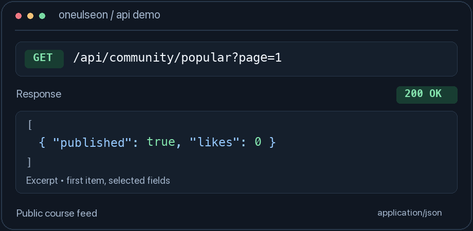

안녕하세요 👋 **3년차 백엔드 개발자 신재효**입니다.

**About me**

- ☕ Java와 Spring을 주로 써요.
- 🛠️ 개인 프로젝트로 데이트 코스를 추천해 주는 [오늘선](https://156.228.4.172/)을 만들고 있어요.

<code></code>
<code></code>
<code></code>
<code></code>

